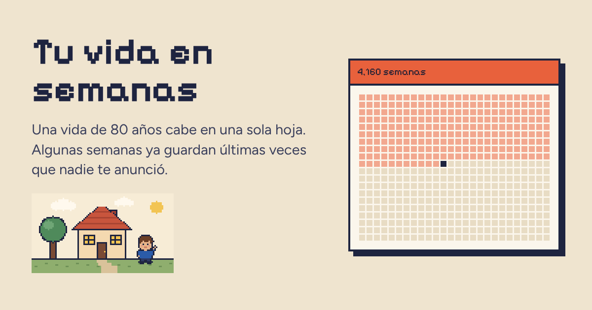
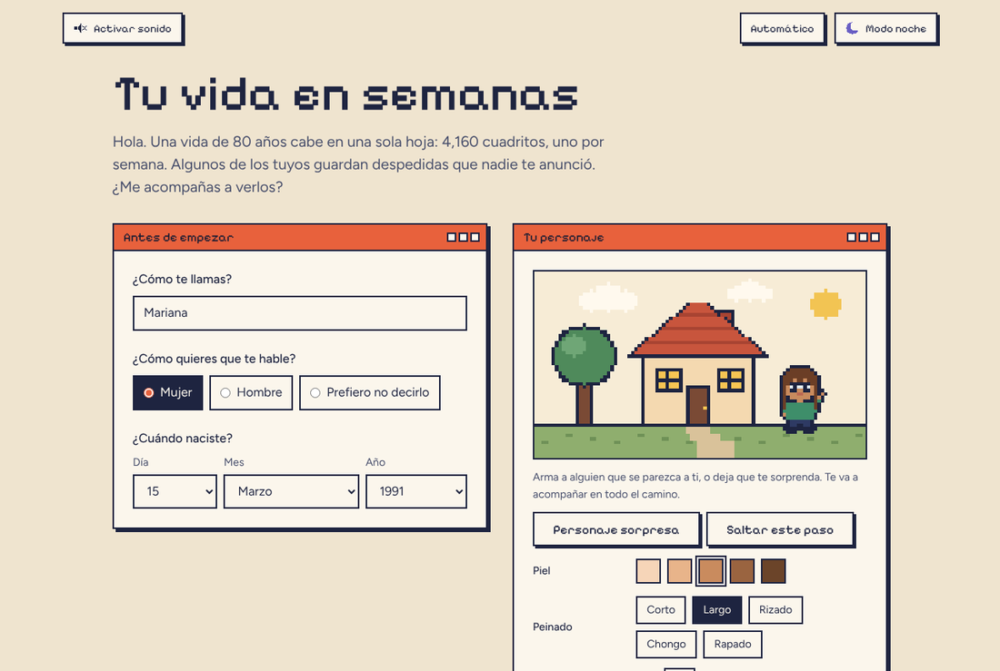
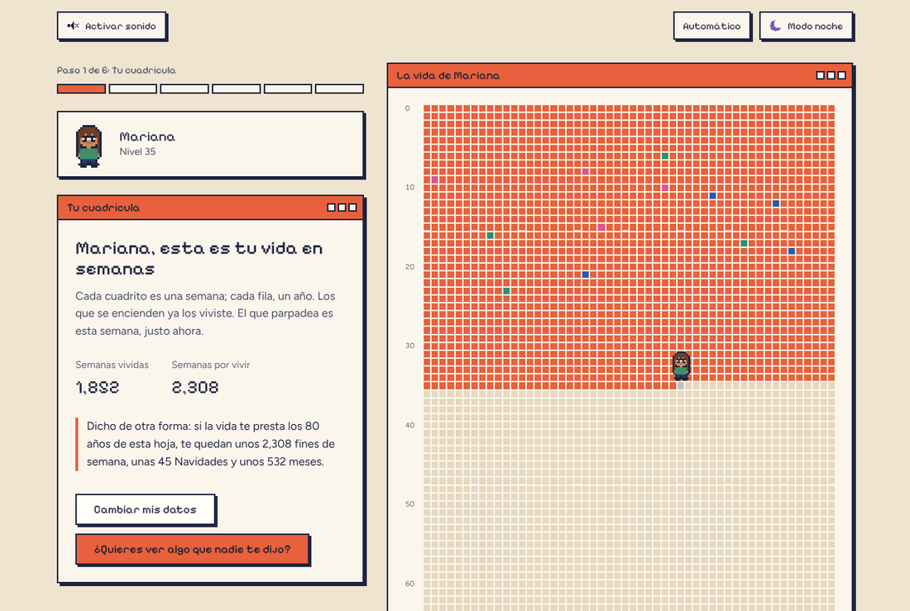
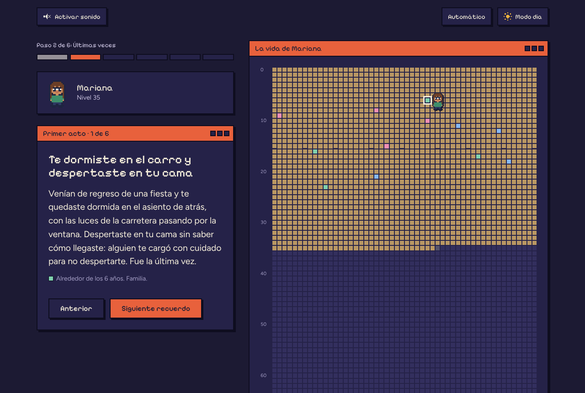
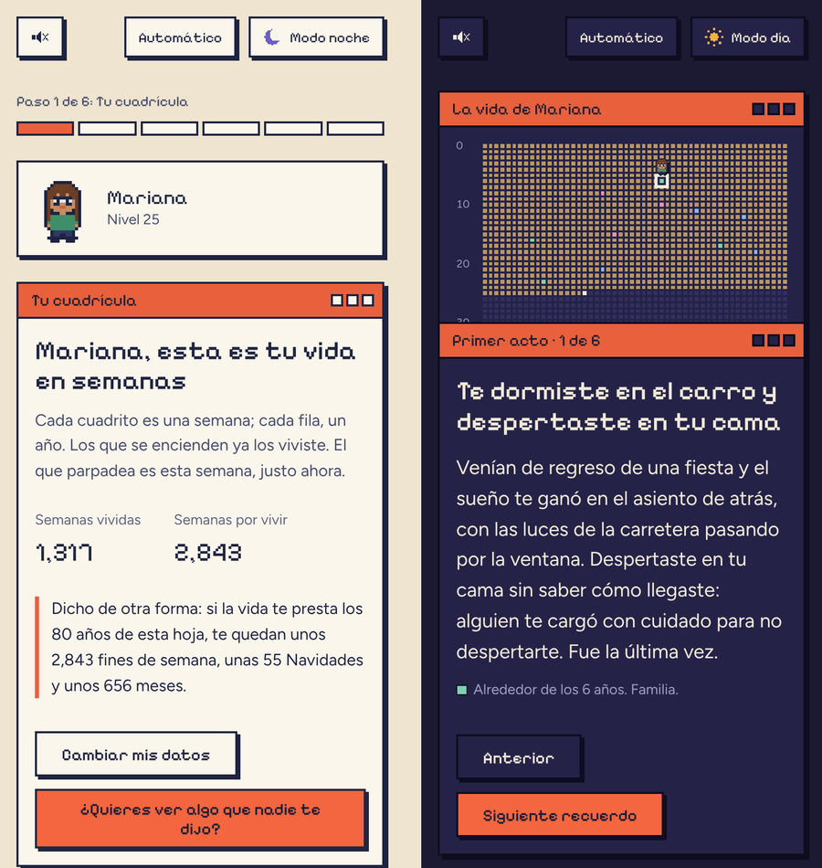
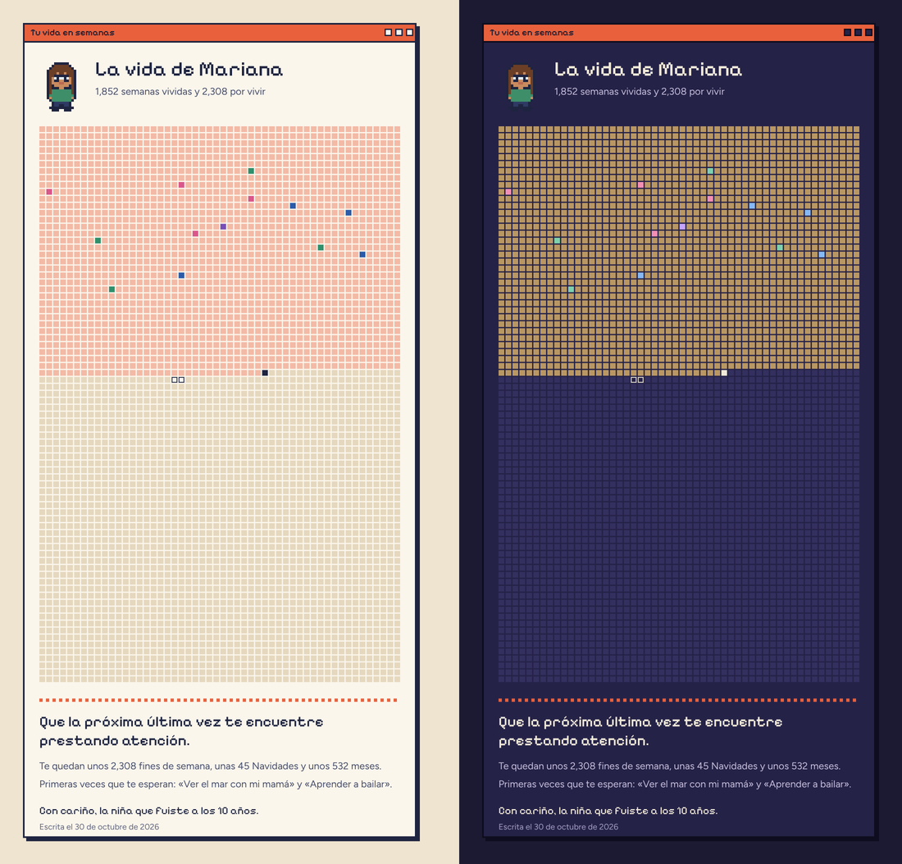

# Tu vida en semanas

> Una vida de 80 años cabe en una sola hoja: 4,160 cuadritos, uno por semana. Algunos de los tuyos ya guardan despedidas que nadie te anunció.



👉 **Pruébala aquí:** https://xelrojas.github.io/ultimas-veces/ 

---

## Por qué la hice

Un día vi un video sobre la idea de dibujar la vida en semanas y sobre las **últimas veces**: la última vez que alguien te cargó dormida del carro a tu cama, la última vez que viste caricaturas en pijama un sábado en la mañana o la última vez que viviste en casa de tus papás. Ninguna se anunció. Simplemente pasaron, y te diste cuenta mucho después.

Esa idea se me quedó dando vueltas. Me hizo pensar en las semanas que ya viví, en las que vienen y en la gente con la que las comparto. Cuando llegó el momento de elegir el proyecto final de mi **Curso de Vibecoding**, supe que quería convertir esa sensación en algo que otras personas pudieran vivir en carne propia, no solo leer.

Así nació *Tu vida en semanas*: una página pequeña, con estética de videojuego viejito, que te acompaña a ver tu vida completa en una hoja, a encontrar tus propias últimas veces y, al final, a sembrar algunas **primeras veces** en las semanas que quedan.

No busca ponerte triste. Busca que la próxima última vez te encuentre prestando atención.

## Qué vas a vivir

1. **Bienvenida.** Te pregunto tu nombre, cómo quieres que te hable y cuándo naciste. Armas a tu personaje pixel art (o dejas que te sorprenda uno al azar).
2. **Tu cuadrícula.** Tus semanas vividas se encienden fila por fila y la de hoy parpadea. Lo que queda te lo digo a escala humana: fines de semana, Navidades y meses.
3. **Últimas veces, en dos actos.** Primero la infancia ("Cuando todo era para siempre") y luego la juventud ("Cuando empezaste a darte cuenta"). Tu personaje camina por la cuadrícula hasta cada recuerdo y cambia de edad en el camino.
4. **Las tuyas.** Una tarjeta a la vez me dices si ya viviste cada una y a qué edad. También puedes agregar recuerdos propios y elegir el color de tus semanas.
5. **Una pausa.** Casi vacía, a propósito: *"Ninguna de estas despedidas fue anunciada. Las próximas tampoco lo serán."*
6. **Lo que viene.** Escribes hasta tres cosas que quieres hacer por primera vez y aparecen como semillas en tus semanas futuras.
7. **Una carta para ti.** Tu personaje en su casita y una carta que usa tus propias palabras. Puedes descargar tu cuadrícula como imagen e invitar a alguien a hacer la suya.

## Capturas

| Bienvenida | Tu cuadrícula |
|---|---|
|  |  |

| Una última vez, en Noche de lámparas | En el celular |
|---|---|
|  |  |

**La imagen que te llevas**, en modo de día y de noche:



## Cómo la construí

Este proyecto lo hice con *vibecoding*: conversando con **Claude** como compañero de programación, describiendo lo que quería sentir en cada pantalla y revisando cada versión hasta que se sintiera bien. Lo guardé y lo publiqué con **GitHub**.

Fue creciendo por fases, y en cada una aprendí algo:

1. **La idea base.** Primero escribí qué quería que la persona sintiera, antes de pensar en código.
2. **El estilo.** La casita retro, el personaje pixel art y la paleta (aquí fue donde me quedé con el naranja).
3. **El modo nocturno.** Comparé varias propuestas nostálgicas y elegí *Noche de lámparas*.
4. **Los textos y la historia.** Una narradora, tres actos, una pausa, números a escala humana y una carta íntima al final.
5. **El sonido.** Efectos y música 8-bit que acompañan sin estorbar.
6. **Las animaciones.** Que el personaje respire, salude, camine y cambie de edad.
7. **La usabilidad.** Selectores de fecha en español, poder saltar pasos, volver atrás, una barra de avance y que no pierdas tu avance si recargas la página.
8. **El cierre.** El enlace para compartir, una auditoría general (accesibilidad, contraste de colores, HTML válido, pruebas en computadora y celular) y este README.

Lo que más me llevo: el código fue la parte fácil de explicar. Lo difícil, y lo más bonito, fue decidir **qué** quería decir y **cómo** quería que se sintiera.

## Con qué está hecha

- **HTML, CSS y JavaScript**, sin librerías ni herramientas de compilación. Se abre directo en el navegador.
- **Canvas** para dibujar el personaje y la casita pixel por pixel.
- **Web Audio** para los sonidos 8-bit.
- **Web Animations** para que el personaje camine por la cuadrícula.
- **Fuentes alojadas en el proyecto:** Pixelify Sans para los títulos y Figtree para leer cómodo.
- **Accesibilidad:** se puede usar solo con teclado, funciona con lectores de pantalla, cumple el contraste de colores AA y respeta la opción de "reducir movimiento" de tu dispositivo.

## Tu privacidad

No hay servidor ni base de datos: **nada de lo que escribes sale de tu navegador.** Para que no pierdas tu avance si recargas la página, se guarda solo en tu navegador, caduca a los 60 días y el botón "Empezar de nuevo" lo borra. Si usas modo privado, la página funciona igual, solo que no recuerda el avance.

## Pruébala en tu computadora

Descarga o clona este repositorio y haz doble clic en `index.html`. No necesitas instalar nada.

Para probar que el avance se recupera al recargar, ábrela con un servidor local (por ejemplo, la extensión **Live Server** de VS Code): algunos navegadores guardan de forma menos confiable cuando la página se abre como archivo.

## Cómo está organizada

```
vida-en-semanas/
├── index.html        Estructura de la página y los pasos
├── css/styles.css    Diseño: colores, tipografía, ventanas, cuadrícula y versión para celular
├── fonts/            Fuentes alojadas en el proyecto (con su licencia SIL OFL)
├── img/              Imagen de vista previa para compartir el enlace
├── capturas/         Las capturas de este README
└── js/
    ├── theme.js      Modo de día y Noche de lámparas
    ├── storage.js    Guarda y recupera el avance en tu navegador
    ├── sound.js      Sonidos 8-bit y música chiptune
    ├── language.js   Adapta el texto a cómo quieres que te hable
    ├── data.js       Contenido: últimas veces, actos, categorías y colores
    ├── life.js       Cálculos de edad y semanas
    ├── avatar.js     Personaje pixel art, sus edades y la casita
    ├── animate.js    Respira, parpadea y saluda
    ├── grid.js       La cuadrícula, con mouse, toque y teclado
    ├── walker.js     El personaje que camina sobre la cuadrícula
    ├── export.js     La imagen para descargar
    └── main.js       Une todo: pasos, formularios, la carta y el enlace para compartir
```

**Si quieres hacer tu propia versión:**

- Las últimas veces están en `LAST_TIMES` dentro de `js/data.js`, cada una con su texto en versión mujer, hombre y neutra.
- Los colores están al inicio de `css/styles.css`; los de la noche, en el bloque `:root[data-theme="night"]`.
- La melodía y los efectos están en `js/sound.js`.
- Los peinados y colores del personaje están en `js/avatar.js`.

## Créditos e inspiración

- La idea de ver la vida en semanas viene de **Tim Urban**, en [*Your Life in Weeks*](https://waitbutwhy.com/2014/05/life-weeks.html) (Wait But Why, 2014). Su texto [*The Tail End*](https://waitbutwhy.com/2015/12/the-tail-end.html) (2015) habla justo de cuánto tiempo nos queda con las personas que queremos.
- Las fuentes [Pixelify Sans](https://fonts.google.com/specimen/Pixelify+Sans) y [Figtree](https://fonts.google.com/specimen/Figtree) se usan bajo la licencia SIL Open Font License (incluida en `fonts/`).
- Los textos, el personaje, la casita, la música y el diseño los hice para este proyecto, con ayuda de Claude.


## Sobre mí

Soy ingeniera industrial y Project Manager de proyectos de software, desde México. Me gusta entender cómo funcionan las cosas, ordenarlas y hacer que la gente las disfrute. Este proyecto fue mi primera vez construyendo algo así de personal con código, y no será la última.

Si la hiciste, me encantaría saber qué última vez te encontraste en tu cuadrícula. 🧡
